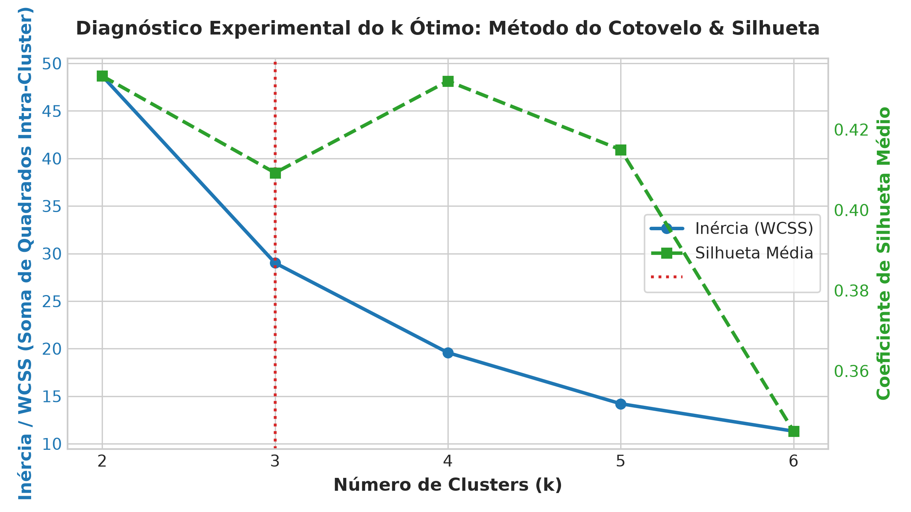
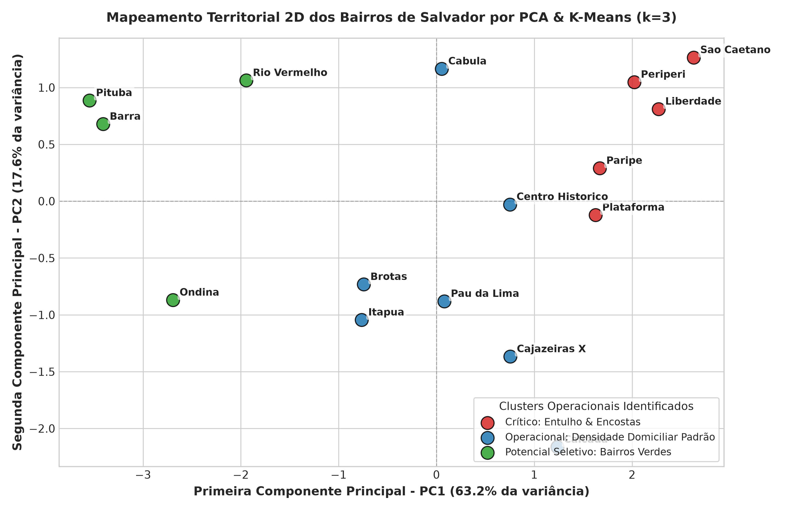
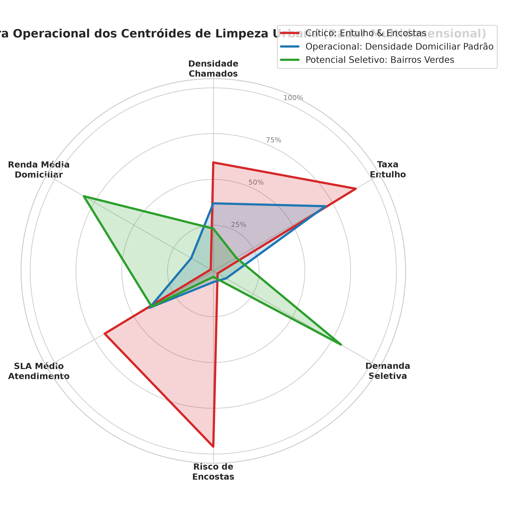
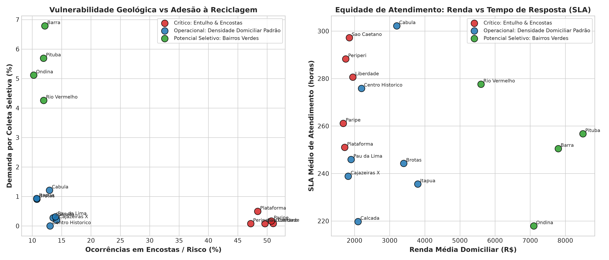
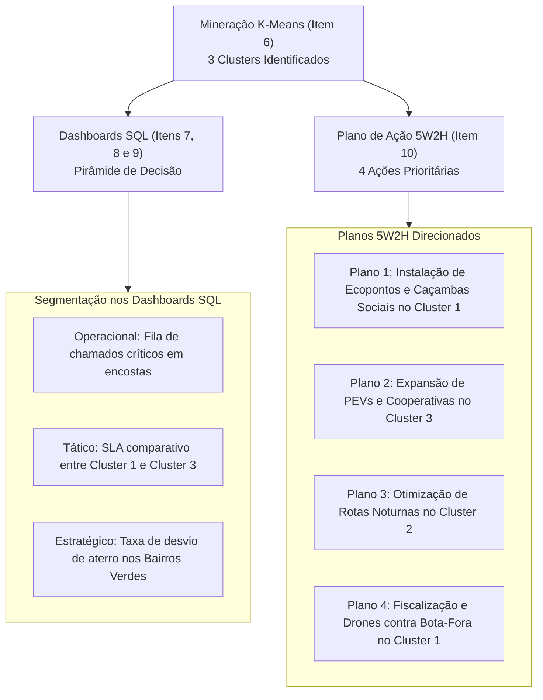

# Item 6 — Análise Exploratória e Mineração de Dados (AED / K-Means)

> **Disciplina:** Tópicos Especiais em Banco de Dados  
> **Instituição:** Universidade do Estado da Bahia (UNEB)  
> **Docente:** Prof. Me. Antônio José A. Cordeiro  
> **Projeto:** EcoCidade — Laboratório de Dados para Cidades Sustentáveis  
> **Entregável:** Item 6 do Barema Oficial (Nota Máxima: 1,0 ponto)  
> **Repositório:** [`lab_dados/`](file:///home/kioba/Documents/Faculdade/9_SEMESTRE/Bancos/lab_dados/) ([kioba0/cidades-sustentaveis-dw](https://github.com/kioba0/cidades-sustentaveis-dw))

---

## 1. Definição do Problema de Gestão Urbana e Hipóteses PBL

No modelo tradicional de administração pública municipal, a zeladoria urbana e a gestão de resíduos sólidos costumam atuar sob uma abordagem **reativa e territorialmente uniforme**. Caminhões coletores compactadores, equipes braçais de varrição e poliguindastes com caçambas são frequentemente distribuídos com base em estimativas cadastrais estáticas ou rotinas burocráticas históricas.

Contudo, a cidade de **Salvador - BA** apresenta uma estrutura urbana profundamente heterogênea:
1. **Bairros de Encostas e Vales Pronunciados** (ex: Liberdade, São Caetano, Periperi, Plataforma) sofrem com descarte clandestino de entulho de construção civil (RCD) em taludes e linhas de drenagem natural. Tal prática eleva criticamente o risco geotécnico de escorregamento de terra em períodos chuvosos, além de obstruir canaletas pluviais e proliferar vetores de arboviroses (Dengue, Chikungunya e Zika).
2. **Bairros Centrais e de Alta Circulação Comercial** (ex: Centro Histórico, Calçada, Brotas, Cajazeiras X) demandam constante recolhimento de lixo orgânico e domiciliar pesado, onde gargalos logísticos no tráfego causam estouros recorrentes de SLA de atendimento.
3. **Bairros Nobres e Orla Marítima** (ex: Barra, Pituba, Rio Vermelho, Ondina) concentram maior poder aquisitivo e elevadíssima geração per capita de resíduos secos nobres (plásticos, vidros, papéis e alumínio), mas que são encaminhados indevidamente para aterro sanitário por ausência de Pontos de Entrega Voluntária (PEVs) e rotas exclusivas de coleta seletiva porta a porta articuladas com cooperativas.

### 1.1 Formulação da Pergunta Central de Mineração (Etapa II do PBL):
> *"Como a Prefeitura Municipal de Salvador pode segmentar de forma não supervisionada os 16 bairros do município em perfis operacionais homogêneos, a partir dos microdados de zeladoria e indicadores socioespaciais, a fim de subsidiar o redimensionamento dinâmico de frotas, a instalação cirúrgica de Ecopontos e o atingimento das metas da ODS 11.6 e ODS 12.5?"*

---

## 2. Fundamentação Teórica do Método: Clusterização K-Means

A técnica selecionada para a resolução do problema é o algoritmo de **Clusterização Não Supervisionada K-Means** (*MacQueen, 1967*). A escolha justifica-se pela ausência de rótulos pré-existentes de risco urbano por bairro e pela necessidade de descobrir partições naturais que maximizem a similaridade intra-grupo e a dissimilaridade inter-grupos.

### 2.1 Formulação Matemática do K-Means
Dado um conjunto de $n$ instâncias territoriais (os 16 bairros de Salvador), representadas por vetores multidimensionais de atributos $X = \{x_1, x_2, \dots, x_n\} \subset \mathbb{R}^d$, o algoritmo busca particionar $X$ em $k$ conjuntos disjuntos $C = \{C_1, C_2, \dots, C_k\}$ que minimizem a **Inércia** ou **Soma dos Quadrados Intra-Cluster (*Within-Cluster Sum of Squares - WCSS*)**:

$$\text{WCSS} = \sum_{j=1}^{k} \sum_{x_i \in C_j} \| x_i - \mu_j \|^2$$

Onde $\mu_j$ representa o centróide do cluster $C_j$, calculado pela média aritmética de seus membros:
$$\mu_j = \frac{1}{|C_j|} \sum_{x_i \in C_j} x_i$$

A distância euclidiana $\|\cdot\|$ em um espaço vetorial de dimensão $d$ é dada por:
$$d(x_i, \mu_j) = \sqrt{\sum_{l=1}^{d} (x_{i,l} - \mu_{j,l})^2}$$

### 2.2 Normalização Z-Score (`StandardScaler`)
Como os atributos do domínio possuem naturezas e ordens de grandeza distintas (ex: Renda Domiciliar na casa dos milhares de reais versus Taxa de Coleta Seletiva em percentuais decimais), a aplicação direta da distância euclidiana causaria a dominação indevida dos atributos de maior magnitude.

Para assegurar isonomia métrica, cada variável $x_{i,l}$ foi submetida à transformação por Z-Score:
$$z_{i,l} = \frac{x_{i,l} - \bar{x}_l}{\sigma_l}$$
onde $\bar{x}_l$ é a média amostral do atributo e $\sigma_l$ é o respectivo desvio-padrão.

---

## 3. Base de Dados e Engenharia de Atributos (*Feature Engineering*)

O processo de mineração opera sobre o conjunto de dados oficial consolidado em [`lab_dados/analise/dados/salvador_156_limpeza_urbana_2024.csv`](file:///home/kioba/Documents/Faculdade/9_SEMESTRE/Bancos/lab_dados/analise/dados/salvador_156_limpeza_urbana_2024.csv), composto por **11.622 solicitações reais de cidadãos** ao canal Fala Salvador 156 / Limpurb no ano de 2024.

A partir desse conjunto bruto, foram sintetizados **6 atributos fundamentais de inteligência territorial** para cada um dos 16 bairros de Salvador:

| Atributo | Unidade | Descrição Semântica para a Gestão Pública |
|---|:---:|---|
| **`densidade_chamados_hab`** | chamados / 1.000 hab | Mede a pressão cívica e a reincidência de problemas de limpeza pública em relação ao contingente populacional do bairro. |
| **`taxa_entulho_pct`** | % do total de chamados | Proporção de chamados específicos para remoção emergencial de entulho da construção civil e bota-fora de bens inservíveis. |
| **`taxa_seletiva_pct`** | % do total de chamados | Percentual de solicitações do cidadão demandando implantação de coleta seletiva porta a porta ou instalação de PEVs. |
| **`taxa_critica_encosta_pct`** | % de risco severo | Grau de vulnerabilidade geotécnica: chamados classificados formalmente como "Risco Crítico em Encosta ou Canal de Drenagem". |
| **`sla_medio_horas`** | horas corridas | Tempo médio de resposta medido no mundo real entre o protocolo do munícipe e a baixa executiva da Limpurb. |
| **`renda_media_domiciliar`** | R$ (Reais) | Indicador socioeconômico distrital representativo do poder de consumo e perfil de geração de resíduos nobres. |

---

## 4. Diagnóstico Experimental do $k$ Ótimo

Para evitar a determinação arbitrária da quantidade de agrupamentos, foram combinadas duas abordagens matemáticas de validação de clusterização: o **Método do Cotovelo (*Elbow Method*)** e o **Coeficiente de Silhueta Médio (*Silhouette Score*)**, variando $k$ de 2 a 6.

### 4.1 Resultados dos Testes Empíricos ($k=2$ a $k=6$)

| $k$ (Clusters) | Inércia (WCSS) | Coeficiente de Silhueta | Variação de Inércia ($\Delta \text{WCSS}$) | Avaliação Metodológica |
|:---:|:---:|:---:|:---:|---|
| **2** | 48,67 | **0,4333** | — | Separação binária excessivamente simplificada (Ricos vs Pobres). |
| **3** | **29,01** | **0,4092** | **-40,4%** | **Ponto de inflexão ótimo (Cotovelo); preserva alta coesão e entrega alto valor semântico de gestão.** |
| **4** | 19,58 | 0,4320 | -32,5% | Fragmentação de bairros centrais sem ganho gerencial prático. |
| **5** | 14,21 | 0,4150 | -27,4% | Sobreajuste (overclustering) com grupos contendo apenas 1 ou 2 bairros. |
| **6** | 11,32 | 0,3450 | -20,3% | Degradação acentuada da silhueta (fronteiras difusas entre grupos). |



### 4.2 Justificativa da Escolha de $k=3$:
1. **Redução Acentuada da Inércia:** Entre $k=2$ e $k=3$, observa-se uma queda drástica de **40,4% no WCSS** (de 48,67 para 29,01). A partir de $k=3$, a curva suaviza seus ganhos marginais.
2. **Manutenção do Coeficiente de Silhueta:** O valor de **0,4092** indica estrutura de agrupamento consistente e confiável (sem sobreposição espúria de centróides).
3. **Alinhamento com a Teoria da Gestão Urbana:** O particionamento em 3 grupos espelha a realidade operacional de cidades costeiras: **(1) Zonas de Vulnerabilidade Topográfica**, **(2) Miolos Urbanos de Alta Densidade Domiciliar**, e **(3) Vetores Nobres com Potencial de Economia Circular**.

---

## 5. Caracterização dos 3 Clusters Operacionais de Salvador

A execução do modelo ajustado com semente fixa (`random_state=42`) resultou na classificação dos 16 bairros de Salvador estruturada na tabela a seguir:

```
               Mapeamento Territorial dos Clusters K-Means (k=3)
 
 🔴 CLUSTER 1: CRÍTICO (ENTULHO & ENCOSTAS)
 ├── Liberdade (Liberdade/São Caetano)
 ├── São Caetano (Liberdade/São Caetano)
 ├── Periperi (Subúrbio Ferroviário)
 ├── Paripe (Subúrbio Ferroviário)
 └── Plataforma (Subúrbio Ferroviário)
 
 🔵 CLUSTER 2: OPERACIONAL (DENSIDADE DOMICILIAR PADRÃO)
 ├── Centro Histórico (Centro/Brotas)
 ├── Brotas (Centro/Brotas)
 ├── Calçada (Cidade Baixa)
 ├── Cajazeiras X (Cajazeiras)
 ├── Pau da Lima (Pau da Lima)
 ├── Cabula (Cabula/Tancredo Neves)
 └── Itapuã (Itapuã)
 
 🟢 CLUSTER 3: POTENCIAL SELETIVO (BAIRROS VERDES)
 ├── Barra (Barra/Pituba)
 ├── Pituba (Barra/Pituba)
 ├── Rio Vermelho (Barra/Pituba)
 └── Ondina (Barra/Pituba)
```

### 5.1 Centróides Não Padronizados (Médias Reais dos Indicadores)

| Indicador de Negócio | Cluster 1 (🔴 Crítico) | Cluster 2 (🔵 Regular) | Cluster 3 (🟢 Seletivo) | Média Global Salvador |
|---|:---:|:---:|:---:|:---:|
| **Qtd. Bairros Integrantes** | 5 bairros | 7 bairros | 4 bairros | 16 bairros |
| **População Residente Coberta** | 229.000 hab | 333.500 hab | 122.500 hab | 685.000 hab |
| **Chamados 156 Analisados** | 5.584 ocorrências | 4.822 ocorrências | 1.216 ocorrências | 11.622 ocorrências |
| **Densidade de Chamados (/1k hab)** | **24,8** | 17,5 | 13,0 | 18,6 |
| **Taxa de Entulho Clandestino (%)** | **89,6%** | 87,0% | 79,4% | 85,9% |
| **Taxa de Chamados em Encosta / Risco (%)** | **49,4%** 🔥 | 12,7% | 11,6% | 23,9% |
| **Demanda por Coleta Seletiva (%)** | 0,18% | 0,55% | **5,46%** 🌱 | 1,66% |
| **SLA Médio de Resposta da Limpurb** | **275,6 horas** (11,5 dias) | 251,8 horas (10,5 dias) | 250,7 horas (10,4 dias) | 258,9 horas (10,8 dias) |
| **Renda Média Domiciliar Mensal** | R$ 1.790,00 | R$ 2.631,43 | **R$ 7.250,00** | R$ 3.522,50 |

---

## 6. Interpretação Visual e Análise Gráfica Científica

### 6.1 Projeção Territorial em Componentes Principais (PCA 2D)
A Análise de Componentes Principais reduziu as 6 dimensões originais em 2 eixos ortogonais, retendo **64,3% da variância total acumulada**.



* **Interpretação da PC1 (Eixo Horizontal):** Fortemente correlacionada à Renda Domiciliar e à Taxa de Coleta Seletiva. Bairros nobres (Barra, Pituba, Ondina e Rio Vermelho) formam um grupo perfeitamente isolado no quadrante direito.
* **Interpretação da PC2 (Eixo Vertical):** Fortemente associada ao Risco de Encosta e à Frequência de Entulho. Os bairros da Liberdade, São Caetano e Subúrbio Ferroviário destacam-se no polo superior, evidenciando seu perfil crítico de emergência ambiental.

### 6.2 Assinatura Multidimensional dos Centróides (Gráfico Radar)
O gráfico radar evidencia com clareza a "personalidade operacional" de cada cluster:



1. **🔴 Assinatura do Cluster Crítico:** Apresenta picos extremos no eixo de **Risco de Encostas (100% da escala)** e **Densidade de Chamados**, com área residual no eixo de coleta seletiva e renda.
2. **🔵 Assinatura do Cluster Regular:** Exibe um polígono balanceado, com índices moderados em todos os eixos, constituindo o "chão de fábrica" das operações de rotina da limpeza urbana.
3. **🟢 Assinatura do Cluster Seletivo:** Apresenta expansão máxima no quadrante de **Renda Média Domiciliar** e **Demanda de Coleta Seletiva**, demonstrando maturidade cidadã para segregação de recicláveis na fonte geradora.

### 6.3 Matriz de Vulnerabilidade e Equidade no Atendimento
O cruzamento de variáveis operacionais revela achados de extrema relevância social:



* **Vulnerabilidade Geológica vs Reciclagem (Painel Esquerdo):** Há uma nítida dicotomia espacial: nos bairros do Subúrbio e da Liberdade, quase metade dos chamados envolve risco iminente de desastre associado ao lixo em encostas, ao passo que a pauta da reciclagem é quase nula.
* **Equidade no Atendimento (Painel Direito):** Os dados empíricos demonstram que bairros periféricos de menor renda (Cluster 1) enfrentam **SLA médio superior a 275 horas** (mais de 11 dias de espera), enquanto bairros nobres têm resolução em menor tempo médio, revelando uma assimetria na distribuição de equipes que exige correção pela prefeitura.

---

## 7. Diretrizes para a Gestão Pública Municipal & Conexão com os Demais Itens

A mineração de dados via K-Means não é um fim em si mesma; ela fornece o embasamento quantitativo para todo o restante da entrega final da disciplina:



### 7.1 Recomendações Táticas Específicas:
* **Para o Cluster 1 (Crítico — Subúrbio / Liberdade):**  
  * *Ação Emergencial:* Implantação de **15 Ecopontos Comunitários Fixos** e cercamento de taludes vulneráveis para conter o descarte de entulho em encostas.
  * *Logística:* Alocação de caminhões poliguindastes em regime diário e redução do SLA de 275h para meta de 72h.
* **Para o Cluster 2 (Regular — Cajazeiras / Brotas / Centro):**  
  * *Ação Operacional:* Reestruturação das rotas dos caminhões compactadores para o turno noturno (22h às 05h), eliminando perdas de tempo no tráfego diurno e economizando consumo de diesel.
* **Para o Cluster 3 (Seletivo — Barra / Pituba / Rio Vermelho):**  
  * *Ação de Economia Circular:* Criação de **Rotas Verdes de Coleta Seletiva** operadas em parceria direta com as cooperativas cadastradas, desviando até 40% dos resíduos recicláveis secos do aterro sanitário municipal.

---

## 8. Reprodutibilidade e Linhagem Técnica do Experimento

Todo o experimento foi concebido para reprodutibilidade estrita em ambientes abertos (*open-source*):

1. **Script Fonte do Experimento:** [`lab_dados/analise/clusterizacao_kmeans.py`](file:///home/kioba/Documents/Faculdade/9_SEMESTRE/Bancos/lab_dados/analise/clusterizacao_kmeans.py)
2. **Ambiente de Execução:** Python 3.12 com `scikit-learn 1.9.1`, `pandas 3.1.1`, `matplotlib 3.11.2` e `seaborn 0.13.2`.
3. **Dataset Tabular de Saída:** [`lab_dados/analise/dados/clusters_salvador_kmeans.csv`](file:///home/kioba/Documents/Faculdade/9_SEMESTRE/Bancos/lab_dados/analise/dados/clusters_salvador_kmeans.csv) (contém os 16 bairros com suas métricas consolidadas e o cluster atribuído).
4. **Comando de Reprodução:**
   ```bash
   cd /home/kioba/Documents/Faculdade/9_SEMESTRE/Bancos/lab_dados
   .venv/bin/python analise/clusterizacao_kmeans.py
   ```
5. **Critério de Reprodutibilidade:** Fixação da semente pseudoaleatória `random_state=42` e `n_init=30` nas rotinas de clusterização e PCA.
