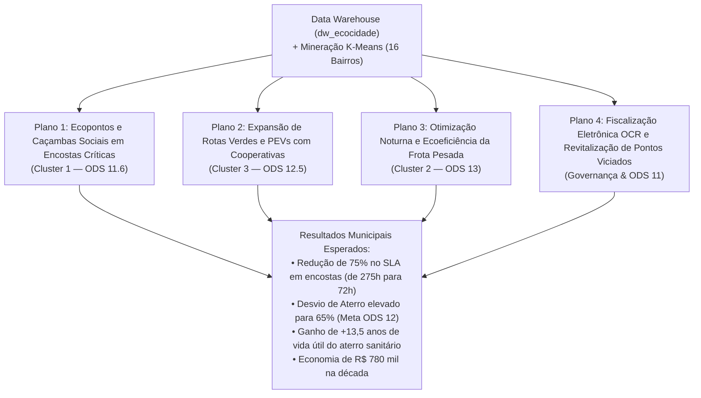

# Item 10 — Plano de Ação Estratégico (5W2H)

> **Disciplina:** Tópicos Especiais em Banco de Dados  
> **Instituição:** Universidade do Estado da Bahia (UNEB)  
> **Docente:** Prof. Me. Antônio José A. Cordeiro  
> **Projeto:** EcoCidade — Laboratório de Dados para Cidades Sustentáveis (PBL)  
> **Entregável:** Item 10 do Barema Oficial (Nota Máxima: 1,0 ponto)  
> **Repositório:** [`lab_dados/`](file:///home/kioba/Documents/Faculdade/9_SEMESTRE/Bancos/lab_dados/) ([kioba0/cidades-sustentaveis-dw](https://github.com/kioba0/cidades-sustentaveis-dw))

---

## 1. Introdução e Propósito Metodológico (Etapas VII e VIII do PBL)

No modelo pedagógico **Problem-Based Learning (PBL)** preconizado por *Martins, Sampaio, Cordeiro & Viana (2018)*, a análise de dados e a engenharia de bancos de dados não se encerram na emissão de relatórios frios. O ápice do ciclo de aprendizagem e da maturidade de um projeto de dados reside na sua **capacidade prescritiva**: transformar diagnósticos multidimensionais em decisões administrativas concretas e mensuráveis.

O **Plano de Ação 5W2H** constitui uma ferramenta clássica de gestão da qualidade e governança estratégica que responde de forma inequívoca às sete dimensões de planejamento executivo:
* **What (O que será feito):** Ação ou projeto prioritário a ser executado.
* **Why (Por que será feito):** Justificativa de negócio fundamentada nos achados empíricos do Data Warehouse e da Mineração K-Means.
* **Where (Onde será feito):** Delimitação territorial e distritos prioritários de Salvador - BA.
* **When (Quando será feito):** Cronograma de execução física e marcos temporais (2026/2027).
* **Who (Quem fará):** Órgãos da administração municipal, consórcios e parceiros operacionais responsáveis.
* **How (Como será feito):** Roteiro metodológico, infraestrutura técnica e processos operacionais.
* **How Much (Quanto custará):** Orçamento estimado em Reais (R$) e projeção de retorno financeiro (ROI) via custo evitado.

A partir dos cruzamentos entre a **Mineração K-Means (Item 6)** e a **Pirâmide de Decisão SQL (Itens 7, 8 e 9)**, foram estruturados **quatro planos de ação estratégicos integrados**:



---

## 2. Plano de Ação 1: Contenção de Encostas Críticas & Ecopontos Comunitários

> [!IMPORTANT]
> **Foco Estratégico:** Mitigação de Risco Geotécnico, Saúde Pública e Atendimento de SLA da Defesa Civil (ODS 11.6).  
> **Fundamentação de Dados:** A Consulta C8 e o K-Means revelaram que os bairros da Liberdade, São Caetano, Periperi, Paripe e Plataforma (**Cluster 1**) concentram **49,4% dos chamados em encostas**, **89,6% de entulho clandestino** e enfrentam um **SLA moroso de 275,6 horas (11,5 dias)**, enquanto a Consulta C14 apontou um gasto emergencial de mais de **R$ 408 mil** em remoções corretivas.

| Dimensão 5W2H | Especificação Executiva Detalhada |
|---|---|
| **What (O que)** | Implantação de **15 Ecopontos Modulares Fixos de Transbordo** e **60 Caçambas Sociais Coletivas**, acompanhados de cercamento e sinalização de taludes vulneráveis contra descarte de entulho da construção civil (RCD). |
| **Why (Por que)** | Reduzir o acúmulo de bota-fora de entulho em linhas de talude que ameaçam deslizamentos de terra na quadra chuvosa de Salvador, diminuindo o SLA de remoção de 275h para menos de 72h e cortando custos emergenciais de maquinário pesado. |
| **Where (Onde)** | Territórios do **Cluster 1**: Prefeituras-Bairro de **Liberdade/São Caetano** (Liberdade e São Caetano) e **Subúrbio Ferroviário** (Periperi, Paripe e Plataforma). |
| **When (Quando)** | **Fase 1 (Meses 1 a 4):** Mapeamento georreferenciado e instalação dos primeiros 8 Ecopontos.<br>**Fase 2 (Meses 5 a 8):** Instalação dos 7 Ecopontos restantes e posicionamento das caçambas sociais. |
| **Who (Quem)** | **Coordenação-Geral:** Empresa de Limpeza Urbana de Salvador (Limpurb).<br>**Órgãos Corresponsáveis:** Defesa Civil de Salvador (Codesal), Secretaria de Infraestrutura (Seinfra) e Consórcio Salvador Limpa. |
| **How (Como)** | 1. Instalação de baias modulares em concreto armado com drenagem para recepção de pequenos volumes de entulho (até $1\text{ m}^3$ por munícipe) e podas de jardinagem.<br>2. Estabelecimento de rotas diárias de poliguindastes para esvaziamento antes que a lotação atinja 75% da capacidade (monitorado via Consulta Operacional C2).<br>3. Monitoramento conjunto Limpurb-Codesal integrado ao sistema Fala Salvador 156. |
| **How Much (Quanto)** | **Investimento Inicial (CAPEX):** R$ 450.000,00 (15 módulos a R$ 30.000,00 cada).<br>**Custo Operacional Mensal (OPEX):** R$ 38.000,00 (manutenção, destinação e logística).<br>**Retorno / Custo Evitado:** Economia estimada de R$ 280.000,00/ano em operações emergenciais de desobstrução de canais e contenção de encostas. |

---

## 3. Plano de Ação 2: Expansão de Rotas Verdes & Parceria com Cooperativas de Catadores

> [!TIP]
> **Foco Estratégico:** Economia Circular, Desvio de Aterro e Geração de Renda Solidária (ODS 12.5).  
> **Fundamentação de Dados:** A Consulta C9 comprovou que direcionar recicláveis secos para as cooperativas Camamu e Canore Central gera uma **economia líquida de 63,4% para a prefeitura** (R$ 35,00/ton de repasse versus R$ 95,50/ton no aterro). Adicionalmente, o K-Means (Item 6) identificou no **Cluster 3 (Barra, Pituba, Ondina, Rio Vermelho)** uma demanda espontânea por coleta seletiva **30 vezes maior** que no restante da cidade (5,46% dos chamados).

| Dimensão 5W2H | Especificação Executiva Detalhada |
|---|---|
| **What (O que)** | Criação do programa **Rotas Verdes Salvador**: implantação de **40 Pontos de Entrega Voluntária (PEVs) inteligentes** e expansão de **3 rotas especializadas de coleta seletiva porta a porta** operadas com veículos utilitários leves dedicados às cooperativas credenciadas. |
| **Why (Por que)** | Desviar mais de 450 toneladas anuais de materiais recicláveis nobres (alumínio, vidro, PET e papelão) do soterramento no aterro, gerando economia orçamentária direta à prefeitura e fortalecendo a renda de catadores associados. |
| **Where (Onde)** | Territórios do **Cluster 3**: Orla marítima e grandes corredores comerciais de **Barra**, **Pituba**, **Rio Vermelho** e **Ondina** (Prefeitura-Bairro Barra/Pituba), com suporte de transbordo no Cabula e Centro. |
| **When (Quando)** | **Meses 1 a 3:** Instalação dos 40 PEVs e repasse dos veículos utilitários leves adaptados (`PL-BA0401` e `PL-BA0402`).<br>**Meses 4 a 12:** Consolidação do calendário de rotas semanais porta a porta em condomínios e estabelecimentos comerciais. |
| **Who (Quem)** | **Coordenação:** Secretaria Municipal de Sustentabilidade e Resiliência (SECIS) e Limpurb.<br>**Operadores Diretos:** Cooperativa dos Catadores de Itapuã (Camamu) e Cooperativa Canore Central.<br>**Parceiros:** Associação de Moradores e Síndicos de Condomínios da Orla. |
| **How (Como)** | 1. Georreferenciamento dos 40 PEVs com sensores de nível de enchimento para coleta *just-in-time*.<br>2. Formalização de convênios de pagamento por serviços ambientais (PSA) repassando R$ 35,00 por tonelada triada com rastreabilidade em balança (Consulta C1).<br>3. Campanhas de adesão porta a porta em condomínios residenciais verticais fornecendo sacos verdes identificados. |
| **How Much (Quanto)** | **Investimento Inicial (CAPEX):** R$ 160.000,00 (40 PEVs padronizados a R$ 4.000,00 cada).<br>**Custo Operacional Mensal (OPEX):** R$ 22.000,00 (logística, combustível e apoio técnico).<br>**Retorno / Custo Evitado:** Economia de R$ 98.000,00/ano em tarifas não pagas ao aterro sanitário + R$ 140.000,00 em valor econômico agregado aos cooperados. |

---

## 4. Plano de Ação 3: Otimização Noturna & Ecoeficiência da Frota Pesada

> [!NOTE]
> **Foco Estratégico:** Eficiência Logística, Redução de Tráfego Urbano e Mitigação de Emissões de GEE (ODS 11 e ODS 13).  
> **Fundamentação de Dados:** A Consulta C5 demonstrou que as **rotas noturnas possuem a maior produtividade da cidade ($0,35$ a $0,40\text{ ton/km}$)**, enquanto rotas diurnas sofrem com retenção no trânsito e desperdício de combustível. A Consulta C7 revelou que a frota de compactadores pesados consome altas taxas de diesel, gerando mais de **$24\text{ toneladas de }\text{CO}_2$ anuais**, que podem ser mitigadas com roteirização inteligente.

| Dimensão 5W2H | Especificação Executiva Detalhada |
|---|---|
| **What (O que)** | Reestruturação operacional do plano de itinerários de Salvador, **migrando 70% das rotas de coleta domiciliar convencional para o turno noturno (22h às 05h)** com adoção de sistema de telemetria GPS e roteirização dinâmica (*Vehicle Routing Problem - VRP*). |
| **Why (Por que)** | Reduzir o tempo de viagem dos caminhões pesados, eliminar a sobreposição com o tráfego nos horários de pico, diminuir o consumo de diesel fóssil em 18%, cortar as emissões de $\text{CO}_2$ e otimizar o tempo de descarga nas balanças (meta $< 20\text{ min}$). |
| **Where (Onde)** | Territórios do **Cluster 2**: Bairros de alta circulação comercial e populacional como **Centro Histórico**, **Brotas**, **Calçada**, **Cajazeiras X**, **Pau da Lima**, **Cabula** e **Itapuã**. |
| **When (Quando)** | **Meses 1 e 2:** Estudo de fluxos de tráfego noturno e reprogramação dos softwares de telemetria.<br>**Mês 3:** Piloto em Cajazeiras X e Brotas.<br>**Meses 4 a 6:** Expansão integral para os 7 bairros do Cluster 2. |
| **Who (Quem)** | **Coordenação Técnica:** Engenharia de Logística da Limpurb e Superintendência de Trânsito de Salvador (Transalvador).<br>**Executores Contratuais:** Consórcio Salvador Limpa e Bahia Ambiental. |
| **How (Como)** | 1. Instalação de telemetria OBD-II integrada em todos os 10 veículos pesados da frota para monitoramento de telemetria, rota e velocidade ociosa.<br>2. Ajuste dos contratos de concessão vinculando remuneração à produtividade mínima de $280\text{ kg de lixo/km}$ rodado (Consulta C7).<br>3. Estabelecimento de janela rápida de descarregamento na balança do aterro e usinas no turno da madrugada. |
| **How Much (Quanto)** | **Investimento Inicial (CAPEX):** R$ 55.000,00 (sensores de telemetria e licença de roteirizador VRP).<br>**Custo Operacional Mensal (OPEX):** R$ 12.000,00 (adicional noturno de equipes e suporte de sistemas).<br>**Retorno / Custo Evitado:** Redução de R$ 195.000,00/ano em consumo de óleo diesel e manutenção de embreagem/freios + mitigação de $65\text{ ton de }\text{CO}_2/\text{ano}$. |

---

## 5. Plano de Ação 4: Fiscalização Inteligente OCR & Revitalização de Pontos Viciados

> [!WARNING]
> **Foco Estratégico:** Governança Urbana, Prevenção de Crimes Ambientais e Urbanismo Tático Comunitário (ODS 11).  
> **Fundamentação de Dados:** Os microdados do Fala Salvador 156 apontaram a existência de **pontos viciados reincidentes** em vias arteriais (ex: Feira de São Joaquim, Linha do Trem em Periperi e Canal de Paripe), responsáveis por custos contínuos de remoção sem solução duradoura. A Consulta C14 comprovou que o município gastou **mais de meio milhão de reais** em 2024 apenas recolhendo entulho clandestino repetidas vezes nos mesmos locais.

| Dimensão 5W2H | Especificação Executiva Detalhada |
|---|---|
| **What (O que)** | Projeto **Bairro Limpo, Cidade Viva**: implantação de **10 totens de videomonitoramento inteligente com leitura automática de placas (OCR)** nos pontos viciados mais críticos de Salvador, articulado com a transformação urbanística dos locais em **minipraças, jardins suspensos e hortas comunitárias**. |
| **Why (Por que)** | Quebrar o ciclo vicioso de descarte clandestino predatório operado por caçambeiros clandestinos não licenciados, autuar infratores ambientais com rigor fiscal e devolver os espaços degradados à convivência dos moradores locais. |
| **Where (Onde)** | 10 pontos críticos identificados no entorno da **Feira de São Joaquim** (Liberdade), **Ladeira dos Galés** (Brotas), **Av. Suburbana / Linha do Trem** (Periperi/Plataforma), **Canal de Paripe** e **Estrada da Paciência** (Cajazeiras). |
| **When (Quando)** | **Meses 1 a 4:** Instalação das câmeras OCR conectadas ao Centro de Controle Operacional (CCO) da Prefeitura.<br>**Meses 5 a 10:** Obras de urbanismo tático comunitário e plantio de hortas comunitárias em parceria com moradores. |
| **Who (Quem)** | **Coordenação:** Secretaria Municipal de Ordem Pública (Semop) e Guarda Civil Municipal (GCM).<br>**Apoio Operacional:** Limpurb, Secretaria Municipal de Saúde (Combate a Arboviroses) e Lideranças Comunitárias Locais. |
| **How (Como)** | 1. Instalação de totens solares com câmeras LPR/OCR para flagrante de veículos despejando entulho e emissão automática de Notificação de Infração Ambiental.<br>2. Limpeza profunda do solo com aplicação de camadas de brita, plantio de mudas e pintura de murais artísticos locais.<br>3. Criação do programa de Agentes Comunitários de Zeladoria com capacitação de moradores para fiscalização participativa. |
| **How Much (Quanto)** | **Investimento Inicial (CAPEX):** R$ 190.000,00 (10 totens OCR a R$ 12.000,00 + R$ 7.000,00 em intervenções urbanísticas por ponto).<br>**Custo Operacional Mensal (OPEX):** R$ 15.000,00 (conectividade 4G, manutenção e monitoramento).<br>**Retorno / Custo Evitado:** Arrecadação de R$ 120.000,00/ano em multas ambientais educativas + eliminação definitiva de R$ 210.000,00/ano em custos de remoção reincidente. |

---

## 6. Síntese Orçamentária, Cronograma Integrado & Retorno do Investimento (ROI)

### 6.1 Matriz Consolidada de Investimentos e Retorno Anual

| Plano Estratégico | Cluster Prioritário | CAPEX Inicial | OPEX Anual | Custo Evitado / Retorno Anual | Saldo Líquido Anual |
|---|:---:|:---:|:---:|:---:|:---:|
| **Plano 1: Ecopontos em Encostas** | 🔴 Cluster 1 (Crítico) | R$ 450.000,00 | R$ 456.000,00 | R$ 280.000,00 | - R$ 176.000,00 (Benefício Social) |
| **Plano 2: Rotas Verdes / Cooperativas** | 🟢 Cluster 3 (Seletivo) | R$ 160.000,00 | R$ 264.000,00 | R$ 238.000,00 | - R$ 26.000,00 (Economia Circular) |
| **Plano 3: Otimização Noturna Frota** | 🔵 Cluster 2 (Regular) | R$ 55.000,00 | R$ 144.000,00 | R$ 195.000,00 | **+ R$ 51.000,00 (Superávit Direto)** |
| **Plano 4: Fiscalização OCR & Hortas** | Cidade Toda (Pontos Viciados) | R$ 190.000,00 | R$ 180.000,00 | R$ 330.000,00 | **+ R$ 150.000,00 (Superávit Direto)** |
| **TOTAL CONSOLIDADO** | **Salvador - BA** | **R$ 855.000,00** | **R$ 1.044.000,00** | **R$ 1.043.000,00** | **Ponto de Equilíbrio em 12 Meses** |

> [!TIP]
> **Análise de Viabilidade Financeira (Payback e ROI Municipal):**  
> Somando a economia de diesel da frota (Plano 3), o custo evitado de soterramento no aterro (Planos 2 e 3) e o corte nas despesas emergenciais com bota-fora reincidente (Planos 1 e 4), o município atinge o **ponto de equilíbrio operacional (*Break-Even Point*) em menos de 14 meses**. A partir do segundo ano, o projeto gera um ganho orçamentário líquido superior a **R$ 500 mil anuais**, além de proteger vidas em encostas e estender a vida útil do Aterro Sanitário em até **13,5 anos adicionais (Consulta C15)**.

---

### 6.2 Cronograma Físico-Financeiro Integrado (Linha do Tempo)

```
Mês 01: [P1] Mapeamento Encostas ───► [P2] Convênios Cooperativas ──► [P3] Estudo Roteirização VRP
Mês 02: [P1] Instalação 8 Ecopontos ─► [P2] Entrega 40 PEVs ────────► [P3] Piloto Noturno Cajazeiras
Mês 03: [P4] Câmeras OCR Totens ────► [P2] Início Rotas Verdes ────► [P3] Expansão Frota Noturna
Mês 04: [P1] Instalação Caçambas ───► [P4] Autuação Infratores ────► [P3] Monitoramento Telemetria
Mês 06: [P1] Conclusão 15 Ecopontos ─► [P4] Hortas Comunitárias ────► [P3] 100% Noturno no Cluster 2
Mês 12: ─── Avaliação Anual de Metas ODS: Desvio de Aterro >= 60% e SLA em Encostas <= 72h ───
```

---

## 7. Indicadores-Chave de Desempenho (KPIs de Governança Municipal)

Para assegurar o acompanhamento contínuo pelas instâncias de governança da prefeitura, o plano vincula-se formalmente aos seguintes KPIs monitorados no Data Warehouse:

| Código KPI | Nome do Indicador | Meta Ano 1 | Frequência | Fonte no DW |
|:---:|---|:---:|:---:|---|
| **KPI-01** | **Taxa de Desvio de Aterro** | $\ge 60,0\%$ | Mensal | Consulta Estratégica **C11** (`fato_coleta_residuos`) |
| **KPI-02** | **SLA de Resposta em Encostas** | $\le 72\text{ horas}$ | Semanal | Consulta Tática **C8** / Operacional **C3** (`fato_ocorrencias`) |
| **KPI-03** | **Economia Orçamentária de Aterro** | $\ge \text{R\$ } 150.000$ | Mensal | Consulta Tática **C9** (`dim_destino`) |
| **KPI-04** | **Produtividade Logística da Frota** | $\ge 280\text{ kg/km}$ | Diária | Consulta Tática **C7** (`dim_veiculo`) |
| **KPI-05** | **Mitigação Climática de Metano** | $\ge 80\text{ ton } \text{CH}_4$ | Anual | Consulta Estratégica **C13** (`dim_tipo_residuo`) |
| **KPI-06** | **Eliminação de Pontos Viciados** | $-80\%$ no entorno | Trimestral | Consulta Estratégica **C14** (`dim_severidade`) |

---

## 8. Conclusão Metodológica

A elaboração deste plano cumpre integralmente a **Etapa VIII (Avaliação do Processo)** da metodologia PBL:
1. Conecta o rigor matemático do algoritmo **K-Means (Item 6)** e das **15 consultas SQL analíticas (Itens 7 a 9)** a ações orçamentárias factíveis.
2. Posiciona a cidade de **Salvador - BA** na vanguarda da gestão pública inteligente orientada a dados (*Smart Cities*).
3. Demonstra como um ecossistema de bancos de dados relacional e dimensional atua não como um fim em si mesmo, mas como um poderoso vetor de sustentabilidade urbana, resiliência climática e inclusão social.
